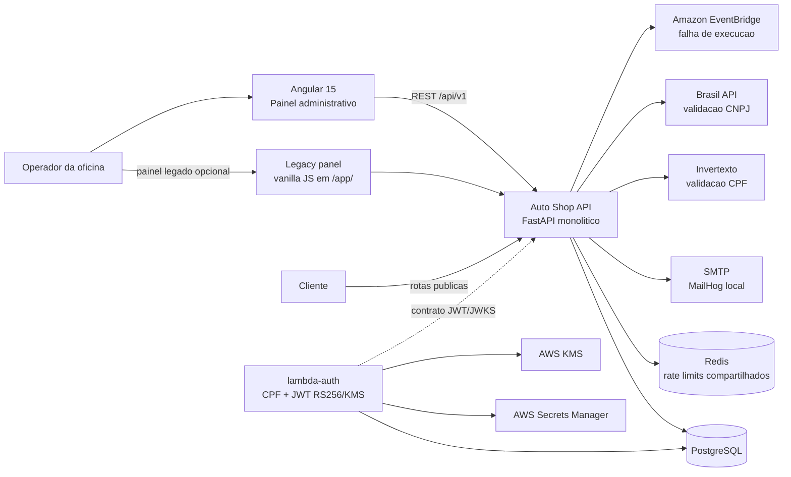
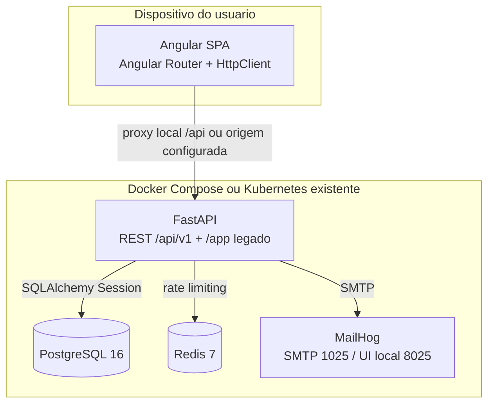
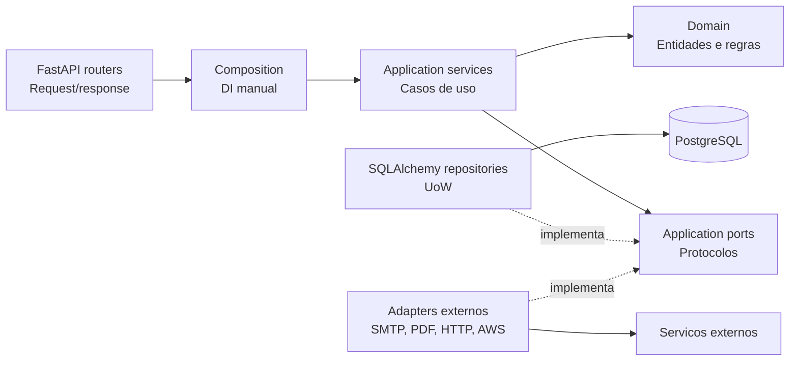
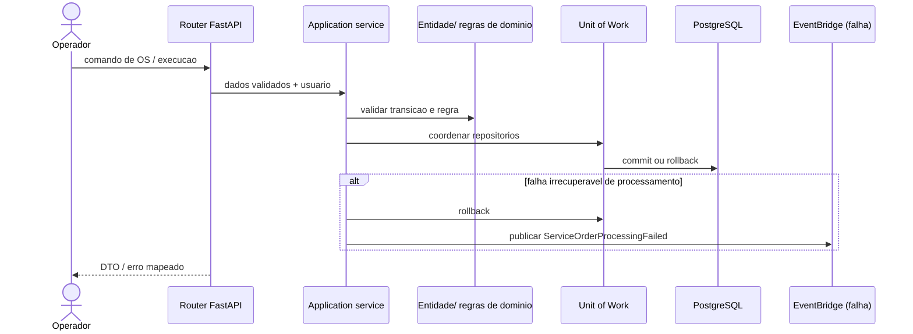
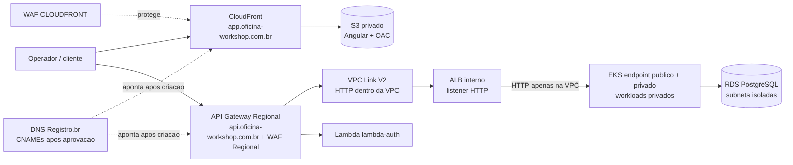
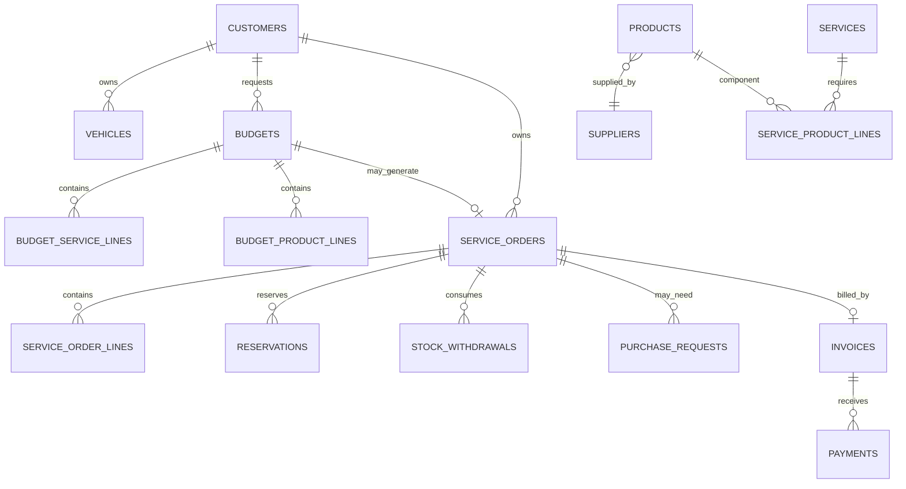

# Project Architecture Blueprint

**Gerado em:** 2026-10-25 · **Estado revisado:** 2026-10-27<br>
**Escopo analisado:** repositorio `auto-shop-system` e repositorio irmao `pos/lambda-auth`<br>
**Objetivo:** descrever a arquitetura observada no codigo e orientar novas mudancas sem confundir o estado atual com o desenho AWS ainda planejado.

## Parametros usados

| Parametro da skill | Escolha |
| --- | --- |
| Tipo de projeto | Deteccao automatica: Python/FastAPI, Angular, Terraform e Kubernetes |
| Padrao arquitetural | Deteccao automatica: monolito em camadas com DDD-light e ports and adapters; servicos auxiliares serverless |
| Diagramas | C4 e fluxos de dados |
| Nivel de detalhe | Comprehensive / implementation-ready |
| Exemplos de codigo | Incluidos, reduzidos a padroes representativos |
| Padroes de implementacao | Incluidos |
| Decisoes arquiteturais | Incluidas, com distincao entre decisoes e infraestrutura implantada |
| Extensibilidade | Incluida |

## 1. Deteccao e analise da arquitetura

O sistema e um produto de gestao de oficina composto por um backend monolitico FastAPI, um painel administrativo Angular, PostgreSQL e componentes auxiliares para integracao. O backend esta organizado por contextos de negocio e camadas. Os repositorios separam interfaces de dominio/aplicacao de adaptadores SQLAlchemy, e a composicao concreta e feita manualmente nos modulos `src/api/composition/`.

Ha dois caminhos auxiliares que precisam ser distinguidos:

1. `gateway/functions/` e `infra/aws/` contem uma integracao antiga com API Gateway, duas Lambdas de login/autorizacao administrativa e proxy HTTP para o backend.
2. O repositorio irmao `pos/lambda-auth` contem uma Lambda separada para autenticar clientes por CPF e emitir JWT RS256 usando AWS KMS. Ela tem seu proprio pacote, testes e modulo Terraform; esse modulo nao cria API Gateway, banco ou rede.

O codigo de deployment atual inclui Docker Compose, manifests Kustomize e um root Terraform que opera recursos dentro de um cluster Kubernetes existente. O Terraform em `infra/aws/` declara recursos AWS para o gateway legado. **O ADR-0071 descreve um alvo futuro para um staging AWS efemero; nao e prova de que esse ambiente exista ou tenha sido implantado.**

### Evidencias de entrada

- Backend: `pyproject.toml`, `src/main.py`, `src/config.py`, `src/domain/`, `src/application/`, `src/infrastructure/` e `src/api/`.
- Frontend: `frontend/package.json`, `frontend/angular.json` e `frontend/src/app/`.
- persistencia: `src/infrastructure/database.py`, `src/infrastructure/persistence/` e `alembic/versions/`.
- Containers e cluster: `Dockerfile`, `docker-compose.yml`, `k8s/` e `infra/`.
- Gateway AWS legado: `infra/aws/` e `gateway/functions/`.
- Lambda de token de cliente: repositorio irmao `pos/lambda-auth/`.
- Decisoes planejadas: `docs/architecture/decisions/ADR-0064-autenticacao-cliente-cpf-jwt.md` e `docs/architecture/decisions/ADR-0071-infraestrutura-cloud-fase-3.md`.

## 2. Visao arquitetural

### Estado implementado

- **Backend:** Python 3.12, FastAPI e SQLAlchemy sincrono, com PostgreSQL e migrations Alembic.
- **Estilo:** monolito em camadas, com separacao por contexto de negocio e ports and adapters. E DDD-light, nao uma implementacao estrita de todos os padroes de DDD.
- **Frontend:** Angular 15 em uma aplicacao SPA com modulos, componentes, servicos, guards e interceptors. O bundle e servido separadamente no desenvolvimento; o backend ainda serve um painel vanilla JS legado em `/app/`.
- **Integracoes:** SMTP, MailHog local, APIs externas de validacao, Redis para limites compartilhados quando configurado, EventBridge para evento de falha de processamento e uma Lambda separada para tokens de clientes.
- **Runtime local:** Docker Compose com API, PostgreSQL, Redis e MailHog.
- **Runtime Kubernetes:** Kustomize e Terraform-Kubernetes descrevem recursos em cluster existente; nenhum dos dois cria EKS ou rede AWS.

### Estado planejado, nao implantado

O ADR-0071 define o alvo de um staging AWS efemero, workload e nodes privados e endpoint EKS publico e privado com autenticacao IAM, RDS, API Gateway Regional, VPC Link V2 para ALB interno, CloudFront/S3 para o Angular, dominios `api.oficina-workshop.com.br`, `app.oficina-workshop.com.br` e `app-hml.oficina-workshop.com.br`, MailHog e Redis efemeros. Em 2026-10-27, CloudFront/S3, dominio proprio e WAF foram confirmados no escopo. A conta `035611741563` esta no plano Paid e recebeu US$ 140 em creditos; o saldo atual nao foi confirmado. A revisao de billing mostrou US$ 0, ainda sujeito a atraso. `STAGING_ACTIVE=false`; nao ha EKS, NAT, RDS ou VPC da sessao ativos, e oito roles IAM permanecem. As decisoes nao autorizam `terraform apply` nem deploy; custo completo e autorizacao especifica de sessao continuam como gates.

## 3. Visualizacao da arquitetura

### 3.1 C4 - contexto do sistema e integracoes observadas

As linhas solidas representam integracoes presentes no codigo. A ligacao pontilhada mostra a relacao entre o emissor separado e o consumidor JWT, que depende de configuracao e de uma URL JWKS alcancavel. O API Gateway da Lambda de CPF ainda precisa ser integrado conforme o ADR e as issues de plataforma.



### 3.2 C4 - containers de execucao atuais



O backend usa `DATABASE_URL`; Redis, CORS, URLs publicas, SMTP, segredos de token e parametros de JWT sao configurados por variaveis lidas por `src/config.py`. Em Kubernetes, ConfigMap e Secret sao recursos distintos. A imagem e construida em duas etapas e o processo final roda como UID/GID `10001`.

### 3.3 C4 - componentes internos do backend



Regra pretendida: handlers HTTP traduzem protocolo e chamam casos de uso; servicos coordenam portas; regras de negocio ficam no dominio; infraestrutura implementa ports. A composicao e manual e explicita em `src/api/composition/`.

### 3.4 Fluxo de ordem de servico e estoque



O fluxo normal de orcamento, OS, reserva, execucao e faturamento e orquestrado por servicos de aplicacao e transacoes relacionais. EventBridge e usado para um evento de falha de execucao; o codigo nao demonstra um event bus geral nem um padrao outbox para todas as transacoes.

### 3.5 Alvo AWS do ADR-0071 - separado do estado atual



Esse diagrama descreve a decisao futura, nao recursos que o blueprint tenha criado ou verificado na AWS. O certificado e os CNAMEs so podem ser definidos depois da criacao aprovada dos recursos e da emissao dos valores pelo servico correspondente.

## 4. Componentes arquiteturais

| Componente | Responsabilidade | evidencia principal |
| --- | --- | --- |
| `src/domain/` | Entidades, value objects, enums, excecoes e regras puras por contexto | `customer/`, `vehicle/`, `budget/`, `service_order/`, `inventory/`, `execution/`, `billing/` |
| `src/application/services/` | Casos de uso e coordenacao de operacoes de negocio | `service_order_service.py`, `budget_approval_service.py`, `execution_service.py` |
| `src/application/ports/` | Contratos para persistencia, UoW, e-mail, PDF, validacao externa e eventos | `unit_of_work.py`, `events.py`, `email.py`, `pdf_generator.py` |
| `src/infrastructure/persistence/` | Implementacoes SQLAlchemy de repositories e gateways | `*_repository.py`, `unit_of_work.py` |
| `src/infrastructure/` | PostgreSQL, auth, SMTP, PDF, APIs externas e EventBridge | `database.py`, `auth/`, `email/`, `external/`, `events/` |
| `src/api/routers/` | Rotas, autenticacao por dependencias, parsing e respostas HTTP | `auth.py`, `budgets.py`, `service_orders.py`, etc. |
| `src/api/composition/` | Montagem explicita dos servicos com adapters concretos por request | `service_orders.py`, `execution.py`, `auth.py` |
| `frontend/src/app/component/` | Telas e componentes de clientes, veiculos, catalogo, produtos, fornecedores, orcamentos e OS | Um conjunto de componentes por fluxo/tela |
| `frontend/src/app/service/` | Chamadas HTTP, sessao, interceptors e notificacoes no Angular | `auth.service.ts`, `service-order.service.ts` |
| `gateway/functions/` | Lambdas legadas para login administrativo e authorizer HS256 | `auth_login/`, `jwt_authorizer/` |
| `pos/lambda-auth/src/lambda_auth/` | Emissor de JWT de cliente por CPF com assinatura RS256/KMS e JWKS | `application/`, `adapters/`, `handler.py` |
| `infra/` + `k8s/` | Instalacao da aplicacao em um cluster Kubernetes existente | Terraform Kubernetes e overlays Kustomize |
| `infra/aws/` | Declaracao Terraform do gateway AWS legado | API Gateway, Lambda, WAF, CloudWatch, dominio opcional |

### Fronteiras e variacoes observadas

- O dominio principal nao importa FastAPI nem SQLAlchemy por contrato arquitetural.
- A composicao usa factories manuais; nao ha container de DI externo.
- `src/api/schemas.py` reune DTOs de varios contextos; nao ha uma pasta de schemas por feature.
- `src/infrastructure/database.py` concentra a declaracao de modelos SQLAlchemy e a criacao de engine/sessao; repositories concretos estao separados.
- Servicos de aplicacao sao majoritariamente coordenadores sincronos com SQLAlchemy sincrono. A API pode expor funcoes `def` e `async def`; evitar adicionar chamadas bloqueantes longas diretamente no event loop.
- O backend hospeda a API e uma aplicacao legada vanilla JS, entao a fronteira de produto ainda nao e exclusivamente API.

## 5. Camadas e regras de dependencia

| Camada | Pode depender de | Deve evitar |
| --- | --- | --- |
| Domain | Biblioteca padrao e outras abstracoes puras do dominio | FastAPI, Pydantic de API, SQLAlchemy, boto3, SMTP, HTTP clients |
| Application | Domain e seus ports | Classes concretas de infraestrutura e routers |
| API | Application, Domain para erros/tipos e composicao | SQL direto e regras de negocio complexas em handlers |
| Infrastructure | Domain/Application ports e bibliotecas de adapters | Regras duplicadas de negocio e acesso vindo diretamente do frontend |
| Angular | Contratos HTTP publicos e tipos de apresentacao | Acesso direto ao banco ou logica de negocio autoritativa |

### Injecao de dependencia

`get_db()` cria e fecha uma `Session`; router ou factory de composicao usa essa sessao para criar repositories e services. A construcao concreta ocorre em `src/api/composition/`. Isso mantem os handlers legiveis e torna simples substituir adapters em testes, embora exija atualizar a composicao ao adicionar uma nova dependencia.

### Unit of Work

`UnitOfWork` define `commit()` e `rollback()` como `Protocol`; `SqlAlchemyUnitOfWork` adapta a `Session`. Os servicos coordenam gravacoes envolvendo varios repositories e escolhem o ponto transacional. O port e propositalmente pequeno; nao presume que todos os repositories sejam transacionais independentes.

## 6. Arquitetura de dados

### Banco principal

PostgreSQL e o armazenamento transacional. SQLAlchemy modela as tabelas; Alembic e o caminho versionado para mudancas de schema. `alembic/env.py` usa o metadata de `src/infrastructure/database.py`. `AUTO_CREATE_SCHEMA` fica desligado nos manifests de aplicacao; migrations sao um passo explicito.

Relacoes de dominio principais:



Observacoes de modelagem:

- Tipo de documento do cliente e inferido do comprimento normalizado: CPF com 11 digitos e CNPJ com 14; o modelo nao precisa de `person_type` para distinguir documento.
- Reservas de estoque sao logicas: disponivel e calculado como estoque fisico menos reservas ativas; a baixa fisica acontece na retirada.
- OS e orcamento possuem estados controlados por enums e regras de transicao nas entidades/servicos.
- Pagamentos e eventos de historico usam chaves unicas/idempotencia em partes do fluxo para evitar duplicacao.
- Migracoes Alembic preservam a evolucao do schema e tratam hardening de tokens, sessoes, auditoria, status e idempotencia.

### persistencia da Lambda de autenticacao

`pos/lambda-auth` la a tabela compartilhada `customers` + `customer_documents` e retorna o ID apenas de um cliente ativo. Usa psycopg 3 e credencial carregada do Secrets Manager via `DatabaseUrlProvider`; nao administra schema nem grants. O desenho de TLS atual do adaptador usa `sslmode="require"`; o ADR-0071 exige `verify-full` com a CA oficial antes do staging, entao essa diferenca precisa ser resolvida na implementacao.

### Cache e estado efemero

- O verificador JWT do backend usa `PyJWKClient` com cache local de JWKS por processo.
- Redis e usado para limites compartilhados quando configurado; counters sao estado descartavel, nao dado de negocio.
- Cache do Secrets Manager da Lambda e mantido em memoria por tempo limitado, conforme configuracao do adapter.
- Nao ha cache distribuido para entidades de dominio no codigo analisado.

## 7. Implementacao de preocupacoes transversais

### Autenticacao e autorizacao

1. **Sessao administrativa web:** `POST /api/v1/auth/login` cria sessao, emite access JWT e refresh token opaco rotativo em cookies; cookies sao HttpOnly, e operacoes mutaveis usam token CSRF (`oficina_csrf` + header `X-CSRF-Token`). O refresh detecta reuso e revoga a familia da sessao.
2. **Admin via gateway legado:** `/gateway-login` emite audience `gateway`; o authorizer Lambda legado valida HS256 e adiciona contexto do operador. As rotas do backend continuam distinguindo essa audience de sessoes web com audience `web`.
3. **Cliente:** o backend valida JWT RS256 com issuer, audience, claims obrigatorias e JWKS remoto. O emissor esta no repositorio separado e assina por KMS. Os contratos pretendidos no ADR-0071 sao issuer `https://api.oficina-workshop.com.br`, audience `auto-shop-api` e `/.well-known/jwks.json`; a integracao operacional completa depende das alteracoes planejadas no gateway.
4. **Autorizacao de rotas:** dependencias FastAPI resolvem o principal/usuario; guards Angular controlam navegacao, mas nao substituem autorizacao no servidor.

### Erros e resiliencia

- `DomainError` e convertido em status HTTP padronizado (`404`, `422`, `409`, `401`, `403`, `503`) pelo handler global de `src/main.py`.
- Erros de validacao Pydantic recebem resposta 422 traduzida para o contrato da API.
- Health endpoints distinguem processo vivo (`/health/live`) de disponibilidade do PostgreSQL (`/health/ready`).
- O EventBridge e acionado em falha especifica de processamento da OS; erros de publicacao sao registrados sem mascarar o resultado da recuperacao transacional.
- APIs externas devem ficar atras de ports/adapters. Nao ha evidencia de circuit breaker geral; respeitar timeouts e erros controlados existentes.

### Logging e observabilidade

- Backend usa logging Python e carrega contexto de requisicao/correlacao em `src/api/request_context.py`.
- Respostas de rotas publicas e de cliente recebem `Cache-Control: no-store`.
- Kubernetes usa startup, liveness e readiness probes; stdout/stderr seguem para o coletor do cluster.
- O gateway legado declara access logs JSON no CloudWatch com request ID, path, status e latencia.
- Metricas de negocio e APM distribuido nao sao uma camada geral presente em todos os componentes. O ADR-0071 planeja controles adicionais para staging; sao decisoes de destino.

### seguranca

- `src/config.py` usa Pydantic Settings para validar configuracao e aplica regras mais estritas a `staging`/producao.
- CORS usa allowlist por configuracao e nao deve aceitar wildcard com credenciais.
- Middleware define `nosniff`, `DENY`, `no-referrer`, Permissions Policy e CSP; HSTS depende de configuracao. Docs FastAPI sao excecao a CSP pois carregam assets externos.
- A imagem e os Pods rodam sem root; o Pod usa `RuntimeDefault`, filesystem raiz read-only, sem escalada de privilegio e remove capabilities. `/tmp` usa `emptyDir`.
- Segredos nao devem ir para ConfigMap, `.tfvars` versionado, imagem, log ou artefato. O Terraform Kubernetes nao cria/la os valores dos Secrets.
- `infra/aws` atual ainda usa segredo HS256 compartilhado e proxy de backend publico; isso e o desenho antigo e deve ser substituido/adequado antes de uso na topologia privada do ADR-0071.

### Validacao

- Pydantic valida entrada HTTP e schemas de resposta.
- Entidades/value objects validam invariantes e normalizam documentos, placas, enums e valores monetarios.
- CPF/CNPJ combinam digito verificador local, checagem de duplicidade e validacao externa quando habilitada.
- Rota publica de consulta de cliente limita campos retornados; documentos devem permanecer fora de URLs e logs.

### Configuracao

- Local: `.env` e variaveis Docker Compose; nao ler nem versionar o `.env` real.
- Kubernetes: parametros nao sensiveis no ConfigMap; `DATABASE_URL`, chaves e credenciais no Secret preexistente.
- Terraform Kubernetes: inputs versionados apenas em `.tfvars.example`; Secrets sao provisionados externamente.
- Lambda: environment contem IDs/URLs nao-secretos; senha de DB vem do Secrets Manager e a chave privada permanece no KMS.
- Regiao, dominio e valores de producao sao configuracao, nao constantes em regras de negocio.

## 8. Padroes de comunicacao entre servicos

| Origem -> destino | Protocolo/padrao | Sincronia | Observacoes |
| --- | --- | --- | --- |
| Angular -> FastAPI | REST JSON em `/api/v1` | Sincrona | Proxy local `/api/*`; cookies e CSRF para sessao web |
| FastAPI -> PostgreSQL | SQLAlchemy/psycopg2 | Sincrona | Transacoes sob Unit of Work/repositories |
| FastAPI -> Invertexto/Brasil API | HTTP | Sincrona | Adapters externos; CPF autenticado, CNPJ publico |
| FastAPI -> SMTP | SMTP | Sincrona | MailHog local; configuracao de producao exige TLS/credencial |
| FastAPI -> Redis | protocolo Redis | Sincrona | Rate limiting compartilhado; configuracao obrigatoria em modos cloud definidos pelo ADR |
| FastAPI -> EventBridge | AWS SDK `PutEvents` | Sincrona | Apenas evento de falha de execucao demonstrado; nao e fluxo geral de OS |
| API Gateway legado -> FastAPI | HTTP proxy | Sincrona | O Terraform atual pressupoe backend acessivel publicamente via HTTPS |
| API Gateway legado -> Lambdas do gateway | AWS proxy integration | Sincrona | Login administrativo e authorizer HS256 |
| API Gateway planejado -> `lambda-auth` | AWS Lambda proxy | Sincrona | Integracao e rotas JWKS/customer-token ainda precisam ser alinhadas |
| `lambda-auth` -> PostgreSQL/Secrets Manager/KMS | psycopg, AWS SDK | Sincrona | Consulta read-only de cliente e assinatura RS256 |

A API usa versionamento de URL (`/api/v1`). As principais jornadas de dominio continuam sincronas dentro do monolito; pagamentos, estoque e aprovacoes nao dependem de um broker para coordenar o fluxo normal.

## 9. Padroes especificos por tecnologia

### Python / FastAPI

- Routers pequenos por contexto de API, com dependencias FastAPI.
- Schemas Pydantic concentram contratos HTTP; mappers dedicados existem para clientes, OS e veiculos.
- Services de aplicacao coordenam repositories, ports e Unit of Work.
- SQLAlchemy sincrono e usado com engine e `sessionmaker`; a dependencia `get_db()` fecha a sessao depois da requisicao.
- Erros de dominio mantem semantica independente de HTTP e sao mapeados na borda.

### Angular 15

- `AppModule` declara modulos, componentes e interceptors globalmente; nao ha organizacao baseada em standalone components.
- `AppRoutingModule` associa paginas e `AuthGuard`; fluxos publicos de aprovacao/rastreamento tem rotas distintas.
- Servicos agrupam chamadas HTTP por dominio; modelos ficam em `model/models.ts`.
- `AuthInterceptor` envia cookies e header CSRF em metodos mutaveis; `HttpErrorInterceptor` tenta refresh compartilhado para 401 administrativo e centraliza notificacoes.
- `frontend/proxy.conf.json` encaminha `/api/*` para o backend local.

### Terraform e Kubernetes

- `infra/` usa Terraform provider Kubernetes para namespace, ConfigMap, Job de migration, Deployment, Service, HPA, Ingress e PostgreSQL local opcional.
- `k8s/` usa Kustomize com base e overlays `local`, `staging`, `production`, divididos em fases `foundation`, `migration`, `app`, `ingress`.
- Os dois gerenciadores nao devem possuir os mesmos objetos no mesmo namespace simultaneamente.
- `infra/aws/` - Terraform independente para o gateway legado; `pos/lambda-auth/infra/terraform/` cria Lambda e IAM, recebendo rede/segredos/KMS como inputs.

## 10. Padroes de implementacao

### Novo caso de uso no backend

1. Adicionar regra/invariante no contexto de `src/domain/<contexto>/`.
2. Definir ou reutilizar repository/port em `src/application/ports/`.
3. Implementar o servico em `src/application/services/`, sem importar FastAPI ou adapter concreto.
4. Criar/atualizar adapter SQLAlchemy ou integracao em `src/infrastructure/`.
5. Registrar a composicao em `src/api/composition/`.
6. Adicionar schema/mapper/router em `src/api/`; manter handler fino.
7. Criar migration Alembic se mudar o banco; nunca depender de `create_all()`.
8. Cobrir dominio com unit tests, contrato HTTP com integration tests e fluxo multi-repositorio com teste de integracao.

### Exemplo: composicao e fronteira transacional observadas

```python
def compose_service_order_service(db: Session) -> ServiceOrderService:
    return ServiceOrderService(
        service_orders=SqlAlchemyServiceOrderRepository(db),
        contacts=SqlAlchemyServiceOrderContactLookup(db),
        tracking_tokens=HmacServiceOrderTrackingTokenService(),
        uow=SqlAlchemyUnitOfWork(db),
        budgets=SqlAlchemyBudgetRepository(db),
    )
```

A factory escolhe adapters concretos; o servico recebe contratos/colaboradores e nao abre a propria conexao. Preserve esse padrao em vez de instanciar repositories ou SQLAlchemy dentro do router.

### Exemplo: Lambda por portas

```python
class AuthenticateCustomer:
    def __init__(self, customer_repository, token_signer, settings):
        self._customer_repository = customer_repository
        self._token_signer = token_signer
        self._settings = settings
```

O caso de uso nao depende de boto3 ou psycopg; `PostgresCustomerRepository` e `KmsTokenSigner` sao adapters. Ao adicionar dependencia, exponha um port testavel e monte-a no handler.

### Novo fluxo Angular

1. Criar componentes por tela/fluxo no diretorio de dominio em `component/`.
2. Colocar chamadas HTTP em um service com tipos de `model/models.ts`.
3. Usar `AuthGuard` apenas para UX; o backend e a fronteira de autorizacao.
4. Respeitar cookie/CSRF e interceptors; evitar salvar tokens de sessao em `localStorage`.
5. Adicionar rota, estados de loading/erro e testes Jasmine/Karma onde o padrao atual os preve.

### Mudanca de banco ou deployment

- Banco: migration nova, rollout compativel e job separado da inicializacao do processo.
- Imagem: usar referencia imutavel por tag de commit/digest; a CI substitui placeholders ao renderizar manifests.
- Kubernetes: alterar a base quando a regra e comum; overlay apenas quando o ambiente realmente difere.
- Cloud: contratos SSM e roots Terraform sao os definidos no ADR-0071; nao publicar segredos no state ou usar `terraform_remote_state` para ler state de outro root.

## 11. Arquitetura de testes

### Backend principal

- `tests/unit/` testa dominio e servicos com doubles/adapters fake.
- `tests/integration/` cobre APIs, sessoes, JWT, fluxos e contratos HTTP.
- `pytest.ini` define modo assincrono; a CI exige cobertura minima de 80% para `src`, executa Bandit e `pip-audit`.
- A CI tambem valida Compose, renderiza manifests local/staging/production, verifica schema Kubernetes e executa smoke/scale em Kind.

### Frontend

- Angular usa Jasmine/Karma; a CI roda type check com TypeScript, build e testes em Chrome Headless.
- Nao ha Playwright configurado no fluxo observado.

### Lambda de cliente

- `pos/lambda-auth/tests/unit/` testa caso de uso, CPF, config, signer e repositorios com fakes.
- `tests/contract/` valida adaptacao HTTP/API Gateway e o contrato de autenticacao.
- CI roda Ruff e pytest/coverage sem credenciais ou chamadas AWS reais.

### Estrategia por fronteira

- Entidades e value objects: invariantes e transicoes sem banco.
- Application services: efeitos, commits/rollbacks e chamadas a ports com fakes.
- Adapters: SQL, KMS, HTTP e SMTP com testes especificos/contratuais.
- HTTP: status, schemas, autenticacao, CSRF, rate limit e erros sanitizados.
- Integracao local: Kind/Compose e smoke test; nao confundir com validacao AWS real.

## 12. Arquitetura de deployment

### Caminho local

Docker Compose fornece PostgreSQL 16, MailHog e Redis; a API usa Python 3.12. Alternativamente, Poetry roda o backend no host e o Angular usa `ng serve` com proxy local.

### Caminho Kubernetes existente

O Deployment principal usa RollingUpdate, imagem referenciada por placeholder/tag, requests/limits, probes e seguranca non-root. O Job Alembic roda antes do rollout. O Service e interno ao cluster; Ingress NGINX publica host configurado pelos overlays. HPA atualmente parte de 2 e pode escalar ate 10 Pods com CPU/memoria; isso e o baseline do codigo presente, nao o limite economico selecionado para staging AWS.

Terraform `infra/` cria objetos Kubernetes no cluster apontado por kubeconfig e, opcionalmente, PostgreSQL para uso local. Kustomize e outro caminho declarativo para os mesmos tipos de objetos: escolher um proprietario por ambiente.

### Caminho AWS legado no codigo

`infra/aws/` declara API Gateway REST Regional, login e authorizer Lambda, integracao HTTP_PROXY para o backend, WAF regional, logs e dominio opcional com ACM/Route53. O README ainda pressupoe backend HTTPS publico e HS256 compartilhado. Esse e um caminho antigo e nao corresponde ao destino do ADR-0071: workloads/EKS privados com endpoint publico e privado autenticado por IAM, VPC Link V2, Lambda de token de cliente e custom domains separados para frontend/API.

### Caminho AWS alvo

O ADR-0071 vigente preve GitHub Actions, endpoint EKS publico e privado autenticado por IAM access entries, OIDC restrito e sem CodeBuild. A conta ja e Paid e recebeu US$ 140 em creditos; o saldo atual e desconhecido. O desenho ainda exige implementacao, plan revisado, custo completo e autorizacao explicita antes de cada sessao. CloudFront/S3 do Angular, dominio proprio, ACM e WAF permanecem no escopo; o custo precisa inclui-los. O blueprint nao executou Terraform nem fez chamadas AWS.

## 13. Extensao e evolucao

### Adicionar capacidade de negocio

- Escolher contexto (`customer`, `vehicle`, `budget`, `service_order`, `inventory`, `execution`, `billing` etc.) antes de criar arquivo.
- Manter regra no dominio e orquestracao no application service.
- Reusar ports existentes quando o contrato for o mesmo; criar interface nova quando a semantica variar.
- Atualizar schema, migration, API, frontend e testes como fatia vertical.

### Adicionar integracao externa

- Definir um port em `application/ports/`.
- Criar adapter em `infrastructure/` com timeout, validacao, tratamento seguro de falha e sem logs de PII/segredos.
- Injetar pelo composition root e usar fake no teste de servico.
- Atualizar configuracao/documentacao sem colocar credenciais em defaults versionados.

### Evoluir eventos

- Use eventos atuais apenas para os casos documentados. Para um fluxo que nao possa perder evento entre commit e publicacao, avalie outbox transacional antes de adicionar novos publishes diretos pos-commit.
- Versione schema/event type, mantenha `event_id`/correlation e teste idempotencia do consumidor.

### Evoluir deployment

- Nao altere diretamente producao/conta; valide provider, plano, custo e `terraform plan` por root.
- Preserve o limite entre VPC compartilhada, RDS, Lambda e workload conforme contratos do ADR-0071.
- Nao faca certificado/DNS ate confirmar valores produzidos e manter os registros atuais do dominio.

## 14. Exemplos representativos de padroes

### DTO nao e entidade

O router recebe schema Pydantic e chama o servico. A entidade nao deve ser retornada diretamente ao cliente; use response schema e mapper para manter contrato HTTP independente de persistencia.

### Adapter AWS com protocolo

`EventBridgeServiceOrderEventPublisher` recebe um client que satisfaz `Protocol`, permitindo fake em testes, e cria o client boto3 apenas quando necessario. O adapter aplica timeouts curtos e nao envia payload bruto da requisicao.

### Refresh concorrente no Angular

`AuthService.refresh()` compartilha uma unica rotacao concorrente com `shareReplay`; isso evita enviar o mesmo refresh token simultaneamente e provocar deteccao de reuso. O interceptor de erros tenta refresh somente uma vez por requisicao protegida.

### Lambda JWT/JWKS

`KmsTokenSigner` monta header/claims JWT RS256, assina o input por KMS e deriva JWK publico com modulus/exponent RSA. A chave privada nao sai do KMS. O consumidor verifica `alg`, `kid`, `iss`, `aud`, claims obrigatorias e scope customer.

## 15. Decisoes arquiteturais e contratos

- **ADR-0064 - autenticacao de cliente CPF/JWT:** contrato de token de cliente, algoritmo, claims e limites de validade. A implementacao deve manter issuer/audience/JWKS iguais nos dois repositorios.
- **ADR-0066/0067 - OS de cliente e evento de falha:** contratos de jornada publica e sinalizacao de falha ligados ao dominio de OS.
- **ADR-0071 - infraestrutura cloud Fase 3:** alvo de um unico staging AWS efemero, rede e contratos entre repositorios, custom domains, limites de custo e gates de execucao. E decisao de desenho, nao estado implantado.
- **`docs/architecture.md`:** resumo arquitetural historico; confirme detalhes no codigo atual quando houver divergencia.
- **`docs/database/database-schema.mermaid`:** referencia de modelo de dados e relacionamentos.

Quando um contrato mudar, atualize ADRs e testes de contrato junto com produtores e consumidores; nao altere apenas um lado do JWT, evento ou banco compartilhado.

## 16. Governanca arquitetural

### Checks automatizados observados

- GitHub Actions principal em `.github/workflows/security.yml`: pytest com cobertura minima 80%, Bandit, pip-audit, verificacoes de defaults, Docker build, validacao de manifests/Kustomize, schema Kubernetes, Terraform `fmt`/`validate`/plan em Kind, smoke local e HPA.
- CI do `frontend/`: type check, build e Karma/Jasmine.
- CI do `pos/lambda-auth`: Ruff e pytest/coverage, sem AWS credentials.
- Fluxo AWS/PR com OIDC e acesso ao EKS via IAM access entries permanece no desenho/plano de plataforma; nao e criado pelo pipeline atual do root. CodeBuild foi removido do desenho vigente.

### Revisao humana recomendada

1. Confirmar proprietario da feature e contexto de dominio.
2. Revisar direcao de dependencias, esquema de banco e autorizacao.
3. Conferir migracao/rollback e comportamento sob concorrencia.
4. Revisar segredos, logs, rate limits e configuracao por ambiente.
5. Inspecionar o plano Terraform e custo antes de qualquer acao remota.
6. Exigir evidencia de teste/integridade correspondente a fronteira alterada.

## 17. Blueprint para novas mudancas

### Workflow

1. Leia ADRs, requirement/task do dominio e implementacao atual.
2. Defina a fronteira afetada: API, application, domain, adapter, frontend, banco ou plataforma.
3. Escreva contrato e invariantes antes de escolher a implementacao concreta.
4. faca alteracao vertical pequena; mantenha compatibilidade API/schema quando possivel.
5. Adicione migration Alembic e testes proporcionais a fronteira.
6. Valide localmente/CI; para deployment, revisar imagem imutavel, migrations, probes e rollback.
7. Atualize ADR/blueprint se mudar uma decisao arquitetural, nao para cada refactor local.

### Templates de localizacao

| Mudanca | Local inicial | Integracao |
| --- | --- | --- |
| Nova regra de cliente/OS/estoque | `src/domain/<contexto>/` | Service -> router -> schema/mapper -> migration/testes |
| Nova operacao de aplicacao | `src/application/services/` | Define/reusa port; compoe via `src/api/composition/` |
| Nova persistencia | `src/application/ports/` + `src/infrastructure/persistence/` | Unit of Work e teste de integracao |
| Novo endpoint | `src/api/routers/` + `src/api/schemas.py` | Autorizacao via dependency e resposta sem entidade ORM |
| Nova tela Angular | `frontend/src/app/component/<fluxo>/` | service tipado, rota/guard e testes Jasmine |
| Nova integracao AWS de autenticacao cliente | `pos/lambda-auth/src/lambda_auth/` | Port + adapter, Terraform de Lambda e contrato API Gateway/JWKS |
| Nova configuracao de app | `src/config.py` | `.env.example`, ConfigMap/Secret por ambiente e validacao de seguranca |
| Nova infraestrutura cloud | Root Terraform dono do recurso | SSM por nome exato, OIDC minimo, plan e custo aprovados |

### Armadilhas a evitar

- Colocar regra de negocio, SQL ou boto3 dentro de routers/componentes Angular.
- Tratar Lambda de login administrativo HS256 como se fosse o emissor RS256 de token de cliente.
- Presumir que Terraform `infra/` cria EKS, VPC, RDS ou IAM; ele opera um cluster ja existente.
- Aplicar Terraform e Kustomize simultaneamente nos mesmos objetos/namespace.
- Considerar o proxy HTTP publico de `infra/aws/` como a arquitetura privada final do ADR-0071.
- Colocar dados sensiveis em Terraform state, ConfigMap, URL, log, imagem ou exemplo versionado.
- Fazer migration na inicializacao de cada Pod ou permitir deploy do app antes da migration aprovada.
- Tratar HPA e CI em Kind como evidencia de capacidade, DNS, certificados ou conectividade AWS real.

### Manter este blueprint atualizado

Atualize a data/escopo quando uma stack, fronteira de servico, contrato de dados, autenticacao, deployment ou ADR mudar. Para detalhes de recursos AWS e custo, prefira o ADR-0071 e os planos de implementacao; este arquivo serve como mapa da arquitetura observada, nao como runbook de provisionamento.
