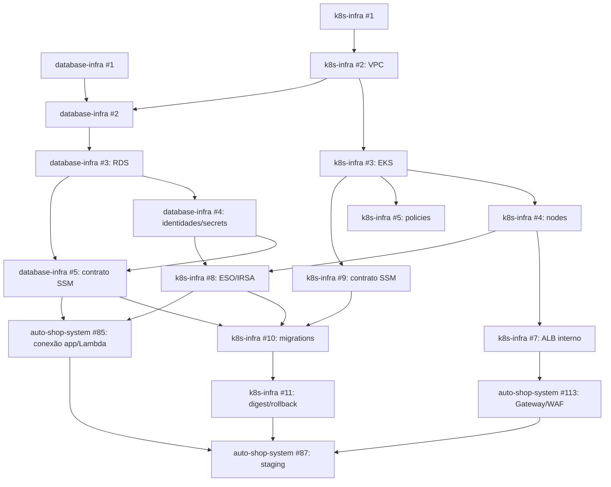

# Guia de implementação — Pessoa 2: plataforma cloud e CI/CD

**Data do plano:** 25/10/2026 
**Janela desejada:** 25–26/10/2026 
**Responsável:** Gustavo (`GustavoAcacioDev`) 
**Base arquitetural:** [ADR-0071](../docs/architecture/decisions/ADR-0071-infraestrutura-cloud-fase-3.md) 
**Mapa integrado e histórico das issues:** [auto-shop-system#98](https://github.com/Software-Architecture-Group-7-FIAP/auto-shop-system/issues/98)

> **Atualização vigente — 2026-10-27:** este guia preserva o plano original e alguns detalhes abaixo foram substituídos. Use como fonte normativa o ADR-0071 e `revisao-fase-2-status-2026-10-27.md`: conta Paid com US$ 140 em créditos concedidos e saldo desconhecido; uma infraestrutura AWS efêmera com ambientes lógicos `hml`/`prd`; endpoint EKS público e privado com IAM, sem CodeBuild; três identidades de banco; bootstrap com init containers `aws-cli` + `postgres:16`, `PutSecretValue` e todo material temporário em tmpfs. CloudFront/S3 do Angular, domínio, ACM e WAF continuam no escopo. Nenhuma dessas decisões autoriza apply; o custo completo e a aprovação da sessão continuam como gates.

## Objetivo e definição de pronto

Entregar uma plataforma AWS reproduzível para a aplicação, a Lambda de autenticação e o PostgreSQL, com acesso privado, identidades separadas, deploy rastreável e um staging demonstrável.

**Escopo aprovado:** haverá um único ambiente AWS, staging/homologação efêmero. O desenvolvimento diário permanece local. Produção e um segundo ambiente AWS estão fora desta fase; não criar overlay Terraform, pipeline de promoção ou sizing de produção.

Uma issue só deve ser considerada concluída quando seus critérios forem comprovados no ambiente correspondente. Terraform válido, CI verde ou recursos declarados não comprovam deploy ou homologação. O marco final de infraestrutura é `auto-shop-system#87`; a homologação funcional da Pessoa 1 (`auto-shop-system#68`) e o delta do Gateway (`auto-shop-system#113`) têm critérios e responsáveis próprios.

## Escopo e issues atuais

Use os números atuais nos repositórios de destino. A tabela de migração dos números antigos está em `auto-shop-system#98`.

| Frente | Issues | Entrega |
|---|---|---|
| Bootstrap do banco | [`database-infra#1`](https://github.com/Software-Architecture-Group-7-FIAP/database-infra/issues/1) | Terraform, state remoto, ambientes e CI do repositório do banco. |
| Rede e RDS | [`database-infra#2`](https://github.com/Software-Architecture-Group-7-FIAP/database-infra/issues/2), [`#3`](https://github.com/Software-Architecture-Group-7-FIAP/database-infra/issues/3) | Subnets privadas/SG do banco e RDS PostgreSQL 16 com KMS, PITR e backups. |
| Identidades e contrato do banco | [`database-infra#4`](https://github.com/Software-Architecture-Group-7-FIAP/database-infra/issues/4), [`#5`](https://github.com/Software-Architecture-Group-7-FIAP/database-infra/issues/5) | Quatro credenciais/grants segregados e parâmetros SSM não secretos. |
| Revisão posterior | [`database-infra#6`](https://github.com/Software-Architecture-Group-7-FIAP/database-infra/issues/6) | Reavaliar RDS Proxy após métricas e aprovação de custo; não bloqueia o primeiro deploy. |
| Bootstrap de cluster | [`k8s-infra#1`](https://github.com/Software-Architecture-Group-7-FIAP/k8s-infra/issues/1) | Terraform, state remoto, ambientes e CI do repositório de plataforma. |
| Rede e EKS | [`k8s-infra#2`](https://github.com/Software-Architecture-Group-7-FIAP/k8s-infra/issues/2), [`#3`](https://github.com/Software-Architecture-Group-7-FIAP/k8s-infra/issues/3), [`#4`](https://github.com/Software-Architecture-Group-7-FIAP/k8s-infra/issues/4) | VPC e workloads privados; endpoint EKS público e privado com IAM access entries; dois nodes On-Demand. Cluster Autoscaler fica fora deste corte. |
| Segurança e escala de Pods | [`k8s-infra#5`](https://github.com/Software-Architecture-Group-7-FIAP/k8s-infra/issues/5), [`#6`](https://github.com/Software-Architecture-Group-7-FIAP/k8s-infra/issues/6) | RBAC, quotas, NetworkPolicy `strict` e HPA medido separadamente do autoscaling de nodes. |
| ALB, secrets e contrato do cluster | [`k8s-infra#7`](https://github.com/Software-Architecture-Group-7-FIAP/k8s-infra/issues/7), [`#8`](https://github.com/Software-Architecture-Group-7-FIAP/k8s-infra/issues/8), [`#9`](https://github.com/Software-Architecture-Group-7-FIAP/k8s-infra/issues/9) | ALB interno, External Secrets Operator, IAM mínimo e parâmetros SSM não secretos. |
| Deploy da aplicação | [`k8s-infra#10`](https://github.com/Software-Architecture-Group-7-FIAP/k8s-infra/issues/10), [`#11`](https://github.com/Software-Architecture-Group-7-FIAP/k8s-infra/issues/11) | Job de migrations antes do rollout, imagem por digest e rollback da aplicação. |
| Integração e staging | [`auto-shop-system#85`](https://github.com/Software-Architecture-Group-7-FIAP/auto-shop-system/issues/85), [`#87`](https://github.com/Software-Architecture-Group-7-FIAP/auto-shop-system/issues/87) | Conexão privada/TLS da aplicação e Lambda; evidência integrada de staging. |

As issues [`auto-shop-system#89`](https://github.com/Software-Architecture-Group-7-FIAP/auto-shop-system/issues/89), [`#90`](https://github.com/Software-Architecture-Group-7-FIAP/auto-shop-system/issues/90) e [`#91`](https://github.com/Software-Architecture-Group-7-FIAP/auto-shop-system/issues/91) cobrem pipelines independentes, deploy/OIDC e proteção de branches sob outra frente. GitHub Actions permanece como orquestrador; os jobs usam runners hospedados pelo GitHub, OIDC e IAM access entries para alcançar o endpoint público autenticado do EKS. Não usar CodeBuild. A integração do API Gateway/WAF está em [`auto-shop-system#113`](https://github.com/Software-Architecture-Group-7-FIAP/auto-shop-system/issues/113), também necessária antes do staging completo.

## Guardrails antes de qualquer provisionamento

1. **Salvaguarda vigente do ADR-0064/0071:** conta `035611741563` Paid, região-base `us-east-1`, uma infraestrutura AWS efêmera com namespaces lógicos `hml`/`prd`, até 4 horas ligada e teardown no mesmo dia. Há US$ 140 em créditos concedidos, mas o saldo atual é desconhecido. Budgets de US$ 1/5/10 são alertas; não há pausa automática nem gatilho de US$ 20 configurado. Recalcular o custo e obter autorização específica da sessão antes de qualquer `terraform apply` ou deploy.
2. Implementar os contratos vigentes do ADR-0071: CIDRs/subnets, EKS 1.37, contratos SSM, grants/JSON de secrets, TLS com CA, Redis e MailHog efêmeros, `api.oficina-workshop.com.br`, `app.oficina-workshop.com.br` e `app-hml.oficina-workshop.com.br`, `/docs` privado e limites iniciais de HPA/WAF. CloudFront/S3, domínio, ACM e os dois WAFs permanecem no escopo. O bootstrap DB usa init containers `aws-cli` + `postgres:16`, `PutSecretValue` e tmpfs; o resolver seguro continua gate de implementação. Revalidar quotas, patch/add-ons, capacidade IP, latência, HPA/WAF e custo antes da sessão.
3. Confirmar ownership de cada recurso: `k8s-infra` é dono da VPC, rede compartilhada e EKS; `database-infra` consome IDs publicados no SSM e cria subnet group e SG do RDS. Não administrar o mesmo recurso por Terraform e Kustomize nem consumir state remoto de outro repositório.
4. Recalcular o custo da sessão antes do apply. Projetar o ciclo completo de criação, até 4 horas ligado e destruição no mesmo dia; incluir state S3, CloudFront/S3, domínio/Registro.br, ACM, WAF Regional e WAF `CLOUDFRONT`, API Gateway, EKS, NAT, RDS, storage, tráfego, logs, KMS, secrets, IPv4, teardown e impostos. Não incluir CodeBuild, NAT por AZ, RDS Multi-AZ ou componentes fora do desenho vigente. Estimativas antigas não aprovam custo. Budgets atuais de US$ 1/5/10 apenas alertam e podem atrasar; não encerram recursos. O saldo dos US$ 140 em créditos concedidos precisa ser confirmado.

### Configuração inicial feita pelo responsável da conta

1. **Concluído:** e-mail raiz e meios de recuperação estão sob controle dos membros ativos. O grupo confirmou que MFA e recuperação estão documentados; mantenha os detalhes fora do Git e não use o root para tarefas diárias.
2. **Concluído:** conta standalone `035611741563`, sem Organization, com MFA da raiz. O usuário confirmou o e-mail raiz sob controle do grupo.
3. **Concluído:** conta atualizada para Paid com US$ 140 em créditos concedidos; o saldo atual não foi confirmado. O antigo registro de Free/US$ 120 foi substituído.
4. **Concluído:** budgets de US$ 1, US$ 5 e US$ 10 são alertas de custo, sem budget actions. Não há limite rígido, desligamento automático ou gatilho configurado de US$ 20. Não gravar e-mail ou telefone no Git; a entrega real ao inbox não foi testada.
5. **Concluído:** IAM user `gustavo-ferreira` no grupo `admin`, com `AdministratorAccess`, MFA virtual e sem access keys. Gustavo será o único operador humano direto nesta fase; não criar usuários adicionais nem compartilhar credenciais. Os demais membros usam PRs/pipelines com OIDC restrito. A CLI autenticou por `aws login --remote` no perfil `oficina-workload`; STS confirmou a conta `035611741563` em `us-east-1`. O perfil administrativo foi autorizado para inspeção somente de leitura nesta etapa. Toda mutação e `terraform apply` requer aprovação específica pelo ADR-0064.
6. **Gate para uma futura sessão AWS:** reautenticar o perfil temporário se expirar, confirmar saldo/custo completo e obter autorização específica antes de provisionar. A conta já está Paid; não há upgrade pendente.
7. Informar à equipe apenas os checkpoints sanitizados se necessário. Não compartilhar senha, MFA, código de login, cartão, token ou arquivos de credenciais.

## Sequência de implementação

### Etapa 0 — fechar pré-requisitos e contratos (desenho concluído; execução bloqueada)

O ADR-0071 agora define os blocos CIDR e subnets, versões e limites iniciais do EKS, sizing candidato de RDS, nomes SSM e leitores, backend remoto, contratos TLS/JWT, domínios, e-mail, Redis, rotas públicas e limites de tráfego. O domínio informado é `oficina-workshop.com.br`; Gustavo confirmou que a zona DNS está no Registro.br e que tem acesso para editá-la. Validar delegação e registros atuais antes de publicar ACM/DNS. Conferir o ADR durante a implementação. Validar com Pessoa 1 os contratos JWT, `DATABASE_URL` e identidade da Lambda; alinhar com Pessoa 3 o ALB interno, WAF/Gateway, deploy e evento.

O registro operacional atual confirma a conta `035611741563` no plano Paid e US$ 140 em créditos concedidos; o saldo atual é desconhecido. O Cost Explorer mostrou US$ 0, sujeito a atraso. As VPCs default `172.31.0.0/16` de `us-east-1` e `us-east-2` não serão reutilizadas; em `us-east-1`, `STAGING_ACTIVE=false` e não há EKS, RDS, NAT ou VPC da sessão ativos. O estado de autenticação, MFA e budgets está registrado no ADR-0071; budgets são alertas e não desligam recursos.

**Estado da etapa 0:** as decisões técnicas estão registradas no ADR-0071. Continuam pendentes validações de delegação/registros DNS, planos, alinhamentos com Pessoas 1 e 3, estimativa completa de custo e aprovação específica da sessão. A conta está Paid; nenhum `terraform apply`, deploy ou outra mutação AWS está autorizado por este guia.

**Saída:** checklist de decisões fechado ou cada pendência registrada como bloqueio explícito; estimativa de custo e plano de execução revisados antes de qualquer apply.

### Próximos passos para o domínio comprado

1. **Confirmado por Gustavo:** `oficina-workshop.com.br` usa DNS no Registro.br, e ele tem acesso para editar a zona. Manter o cadastro e a recuperação acessíveis a um membro ativo do grupo.
2. Antes da futura sessão, conferir no Registro.br a delegação DNS e os registros existentes para evitar substituir entradas em uso. Não enviar senha, MFA ou token do provedor.
3. Durante uma futura sessão AWS explicitamente aprovada, solicitar certificado(s) ACM para `api.oficina-workshop.com.br` e `app.oficina-workshop.com.br`, publicar os CNAMEs de validação DNS e aguardar a validação. Com a região-base atual `us-east-1`, um SAN único pode atender API Gateway, ALB e CloudFront; se a comparação escolher `us-east-2` para API/ALB, manter o certificado do CloudFront em `us-east-1` e emitir outro certificado Regional para API/ALB.
4. Depois de criar os destinos AWS, publicar `api.oficina-workshop.com.br` apontando ao domínio regional do API Gateway e `app.oficina-workshop.com.br` apontando ao CloudFront. Os valores exatos dos CNAMEs são fornecidos pela AWS após o plan/apply aprovado.
5. Validar HTTPS público, CORS restrito às origens Angular hml/prd, fluxo Angular→API e JWKS; desabilitar o hostname `execute-api` padrão só depois desses testes.

CloudFront, domínio, ACM e WAF permanecem no escopo. Criar certificados/registros somente na sessão AWS explicitamente autorizada, após estimativa completa e verificação da zona existente.

### Etapa 1 — preparar os dois repositórios Terraform (local; AWS condicionado à aprovação)

Implementar em paralelo `database-infra#1` e `k8s-infra#1`: módulos reutilizáveis e somente `envs/staging/`; versões Terraform/providers fixadas; backend remoto S3 com versionamento, SSE-S3, TLS obrigatório e `use_lockfile=true` sem DynamoDB; CI por PR para `fmt`, `validate`, análise estática e plan revisável; autenticação OIDC sem access keys estáticas. Usar bucket, prefixos e roles separados para os quatro roots Terraform (`k8s-infra`, `database-infra`, `lambda-auth` e `auto-shop-system/infra/aws`) conforme o contrato do ADR-0071. O bucket persiste entre sessões, tem custo e não deve ser criado antes da autorização; seu state precisa ser preservado antes de eventual encerramento da conta. Não criar `envs/production/` nesta fase nem incluir credenciais em `tfvars`, plan, outputs ou comentários de CI.

**Aceite:** ambos os repositórios passam CI sem criar recursos de aplicação/banco; state local não é usado nos ambientes remotos; os plans não vazam segredo.

### Etapa 2 — construir rede compartilhada e EKS (futura sessão AWS aprovada)

1. Implementar `k8s-infra#2`: VPC `10.80.0.0/20` e subnets conforme o ADR-0071, sem subnet exclusiva para CodeBuild. Validar ranges e IPs restantes no plan. Usar um NAT compartilhado apenas durante sessão aprovada e gateway endpoints S3/DynamoDB. Publicar IDs não secretos usando os nomes SSM fixados.
2. Implementar `k8s-infra#3`: cluster EKS de staging na versão Kubernetes `1.37`, endpoint público e privado, IAM access entries, logs de control plane e versões de add-ons fixadas. Desabilitar suporte estendido e revalidar versão/patch antes de cada sessão. GitHub Actions usa OIDC e IAM access entries; não usar CodeBuild nem access keys estáticas.
3. Implementar `k8s-infra#4`: Managed Node Group privado com dois nodes On-Demand `t3.medium`, `min=2`, `desired=2`, `max=2`, prefix delegation e `max_pods=40`. O Cluster Autoscaler fica fora do corte vigente. Revalidar capacidade e custo antes da próxima sessão.
4. Implementar `k8s-infra#5` antes de selecionar workloads: NetworkPolicy nativa VPC CNI em modo `strict`, default-deny, regras explícitas para CoreDNS, ALB, RDS, serviços AWS e HTTPS de saída via NAT; também Pod Security `restricted`, RBAC mínimo, quotas e LimitRange.

**Aceite:** cluster/nodes saudáveis; acessos permitidos e negados testados; versões, custos e limites registrados. `Pending` sem scale-up e tráfego ainda não testado não contam como validação.

### Etapa 3 — construir RDS, credenciais e contratos SSM (futura sessão AWS aprovada)

1. Em `database-infra#2`, consumir VPC/subnets pelo SSM e criar subnet group e SG próprios do RDS. Permitir 5432 apenas das origens aprovadas, sem CIDR amplo.
2. Em `database-infra#3`, provisionar PostgreSQL 16 privado, criptografado com chave gerenciada AWS e `rds.force_ssl`, Single-AZ; sizing candidato `db.t4g.micro`, 20 GiB gp3. O SG do banco aceita 5432 apenas do SG de nodes EKS e do SG dedicado da Lambda publicados por `k8s-infra`; aplicação, migration e Lambda verificam hostname e CA com `sslmode=verify-full` e CA bundle oficial. Manter backup automático pelo mínimo suportado durante a sessão e validar recuperação. Usar somente dados sintéticos; no teardown, excluir RDS, backups automatizados e snapshots sem conservar snapshot final. Remover os secrets descartáveis sem janela de recuperação e agendar a exclusão da chave RSA KMS de assinatura (espera mínima de sete dias, sem custo mensal de armazenamento enquanto pendente). Registrar parâmetros, classe, armazenamento, janela de manutenção e custos.
3. Em `database-infra#4`, manter três identidades por database: `owner` (master gerenciado pelo RDS, bootstrap e migrations), `app_runtime` (DML sem DDL) e `lambda_auth` (SELECT somente nas colunas exigidas). O bootstrap escolhido usa init containers `aws-cli` + `postgres:16`, calcula SCRAM, publica por `PutSecretValue` e mantém todos os arquivos/segredos em tmpfs. ESO sincroniza apenas `app_runtime`; o resolver seguro ainda é gate. Nunca passar senhas por Terraform/state/plan/logs, usar provider PostgreSQL do Terraform ou reter segredos após a sessão.
4. Publicar `database-infra#5` nos caminhos exatos SSM do ADR-0071: endpoint/porta/SG, nomes `hml`/`prd`, ARNs de `runtime-hml`, `runtime-prd`, `lambda-hml`, `lambda-prd` e `owner`, além dos ARNs das políticas IAM de leitura. Não há identidade separada de migrations. Publicar apenas metadados, nunca valor de `DATABASE_URL` ou segredo master.
5. Em `k8s-infra`, criar Redis `ClusterIP` com senha gerada por sessão, sem PVC e sem backup; rede só aceita Pods da aplicação. Injetar `REDIS_URL` via Secret Kubernetes gerado pelo runner sem registrar valor. Criar MailHog efêmero com SMTP interno 1025, sem envio externo e sem Service público; alterar a validação de configuração para permitir esse sink somente no ambiente `staging`.

**Aceite:** conexões e grants demonstrados; TLS do cliente valida a CA do servidor; acesso externo negado; backup/PITR configurados; parâmetros SSM legíveis somente pelos consumidores exatos.

### Etapa 4 — preparar workloads, entrada privada e migrations (futura sessão AWS aprovada)

1. Implementar `k8s-infra#8`: ESO sincroniza apenas `app_runtime` nos namespaces permitidos. IAM fica restrito aos ARNs exatos e RBAC restringe leitura; `owner` nunca é sincronizado e a Lambda lê seu próprio segredo por role. Criar segredos novos por sessão, sem rotação automática dentro da janela de 4 horas; suspeita de exposição exige encerrar e destruir a sessão.
2. Publicar `k8s-infra#9` com IDs/ARNs de VPC, subnets, cluster, OIDC, namespace e ALB/listener interno; remover host público de Ingress. Consumidores leem parâmetros exatos do SSM.
3. Implementar `k8s-infra#7`: criar ALB interno e listeners HTTP no Terraform; VPC Link V2 usa HTTP dentro da VPC até o ALB, que encaminha HTTP aos Pods privados. Re-criptografia HTTPS até o ALB fica fora do corte atual. `auto-shop-system#113` publica a API via `api.oficina-workshop.com.br` no API Gateway Regional, com WAF Regional; o Angular fica em S3 privado/CloudFront OAC com `app.oficina-workshop.com.br` e `app-hml.oficina-workshop.com.br`, domínio próprio e WAF de escopo `CLOUDFRONT`. O certificado de CloudFront fica em `us-east-1`; o certificado Regional da API Gateway fica na região da API. Validar DNS no provedor controlado pelo grupo, sem exigir Route 53. Desabilitar `execute-api` somente após certificado, DNS e smoke do domínio.
4. Implementar `k8s-infra#10`: Job de migrations com credencial dedicada e digest imutável. O pipeline aguarda `Completed`; em falha, aborta sem atualizar Deployment. Manter advisory lock e migrations expand/contract.
5. Implementar `k8s-infra#11`: Deployment por `repo@sha256:digest`, readiness e `progressDeadlineSeconds`; rollback restaura digest anterior, sem rollback de schema. Testar com smoke em staging.
6. HPA inicia com `minReplicas=1`, `maxReplicas=2`, CPU 70% e memória 80%, usando requests/limits existentes como hipótese. Validar após carga representativa; HPA mede Pods e o node group mantém sizing fixo neste corte, sem Cluster Autoscaler. Requests/limits, limites de réplica e estabilização são documentados com CPU, memória, latência e erros. Não aumentar limites sem nova estimativa de custo.
7. Em `auto-shop-system#90`, publicar o Angular como artefato estático em bucket S3 privado, com CloudFront OAC e hostname `app.oficina-workshop.com.br`. Um job GitHub Actions hospedado usa OIDC com permissão apenas para o bucket de staging e invalidação da distribuição; não precisa entrar na VPC. Preservar rotas do Angular e configurar CORS da API para a origem exata `https://app.oficina-workshop.com.br`.

**Aceite:** deploy não começa antes da migration; falha de migration preserva a versão anterior; ALB não é público; API responde em `https://api.oficina-workshop.com.br` e Angular em `https://app.oficina-workshop.com.br`; S3 não é público; imagem e rollback são rastreáveis por digest; métricas do HPA estão disponíveis.

### Etapa 5 — integrar aplicação/Lambda e demonstrar staging (condicional à aprovação e ao domínio)

Em `auto-shop-system#85`, conectar aplicação e Lambda às subnets privadas com seus próprios security groups e segredos, validar TLS/CA e provar os limites das três identidades por database. A Lambda usa role própria e acesso ao segredo dedicado; não recebe acesso a DDL nem ao master.

Em `auto-shop-system#87`, executar um roteiro de staging com commits/digests rastreáveis: frontend via CloudFront/S3; API via domínio customizado/API Gateway/WAF/VPC Link/ALB/RDS; fluxo Lambda/JWKS; migrations; WAF 429; CORS permitido e origem não permitida; e-mail visível somente no MailHog; Redis/rate limit; NetworkPolicies; HPA e capacidade dos nodes; backups; negação de privilégios indevidos; smoke test e rollback. Trabalhar com a Pessoa responsável por `auto-shop-system#113` e com a Pessoa 3 nas etapas de Gateway e pipeline.

**Aceite:** evidências reais e sanitizadas do único ambiente; cada cenário aprovado/reprovado/bloqueado; recursos, custos por sessão, retenção aprovada e procedimento de teardown documentados. Só depois fechar `#87`; a homologação funcional `#68` continua sendo da Pessoa 1.

### Etapa 6 — reavaliar o proxy depois do primeiro deploy (pós-staging)

Executar `database-infra#6` somente após carga aprovada e métricas de conexões, concorrência da Lambda, erros/timeouts e failover. Comparar RDS direto com Proxy, estimar custo e registrar decisão antes de criar recurso. Essa etapa não bloqueia o staging inicial.

## Dependências principais

`k8s-infra#6` (HPA) é validado após workload e métricas disponíveis; `database-infra#6` é posterior ao staging. `auto-shop-system#89–#91` continuam dependências de pipeline/proteção; o acesso ao EKS usa runners GitHub-hosted, OIDC e IAM access entries, sem runner privado CodeBuild.

## Sequenciamento e viabilidade

| Quando | Prioridade | Resultado ao fim do bloco |
|---|---|---|
| **Agora** | Continuar desenvolvimento local; implementar e revisar contratos, CI e IaC sem acessar/modificar recursos AWS. | Código e PRs revisáveis; nenhuma compra de plano, criação de recursos, apply ou deploy. |
| **Domínio e DNS** | Domínio e provedor confirmados: `oficina-workshop.com.br`, Registro.br; Gustavo tem acesso de edição. Preparar a integração no código e pipeline. | Hostnames são `api.oficina-workshop.com.br` e `app.oficina-workshop.com.br`; validar delegação/registros existentes e aguardar aprovação de custo/sessão AWS antes de criar ACM ou CNAMEs. |
| **Após autorização explícita da sessão** | Recalcular o custo de todo o escopo confirmado, verificar saldo de crédito e aprovar uma sessão de até 4 horas; então criar/reusar state, rede, EKS, RDS, Gateway, CloudFront e executar smoke/teardown. | Staging demonstrável apenas se DNS/ACM, WAFs, IAM/OIDC, quotas, pipelines e bootstrap seguro estiverem prontos. A conta já está Paid; não há runner CodeBuild. As estimativas antigas não substituem a aprovação do ADR-0064. |

**Estimativa realista:** cerca de **45–70 horas de trabalho focado**, sem contar aprovações, criação/propagação de recursos, revisão de PR e espera por equipes externas. Não há data para staging enquanto a decisão for continuar local e o domínio estiver pendente. Quando houver autorização, priorize o caminho integrado e registre como bloqueado qualquer cenário sem ambiente real; não marque #87 como concluída com mocks ou Terraform sem apply.

## Verificações e registro de evidência

Para cada repositório Terraform, executar `terraform fmt -check -recursive`, `terraform validate`, análise estática e revisão do plan. O CI deve usar OIDC e não publicar segredos em logs, artefatos ou comentários. Na integração, validar TLS do PostgreSQL com `verify-full` e CA, TLS público de `api`/`app`, política de rede permitida/negada, grants com comandos positivos e negativos, `kubectl rollout status`, migration antes do rollout, digest implantado e rollback. Confirmar que MailHog não entrega externamente, Redis só aceita Pods da aplicação e ambos desaparecem no teardown.

O relatório de staging deve registrar data/hora, ambiente, commits/digests, revisão Alembic, resultado dos cenários, IDs sanitizados de correlação, custos estimados e limitações/issues. Nunca anexar CPF, JWT, senha, cookie, URL de conexão ou material criptográfico.

## Riscos e respostas

| Risco | Impacto | Resposta |
|---|---|---|
| Aprovação operacional do ADR-0064 não disponível | Nenhum recurso pode ser provisionado; staging não pode ser homologado. | Preparar código e plan revisado; manter apply/deploy como bloqueado até aprovação específica. |
| DNS, IAM ou acesso ao endpoint do EKS indisponível | Certificados, rotas públicas ou deploy de workloads podem falhar. | Domínio e acesso ao Registro.br foram confirmados; validar delegação sem apagar registros existentes. Confirmar trust OIDC/access entries; o EKS aceita acesso público e privado autenticado por IAM. Smoke test antes de desabilitar `execute-api`. |
| Contratos SSM/SG/secrets divergentes entre repositórios | App ou Lambda não conecta, ou recebe acesso excessivo. | Publicar nomes e consumidores antes dos módulos; testar IAM por ARN e rede por origem. |
| NetworkPolicy `strict` aplicada sem regras para DNS/controladores | Pods não inicializam ou falham em chamadas necessárias. | Instalar políticas explícitas antes dos workloads e validar tráfego permitido e negado. |
| Escopo de dois dias comprimido além da capacidade | Critérios ficam marcados como concluídos sem ambiente real. | Separar `código pronto`, `implantado em staging` e `homologado`; não reduzir critérios de aceite. |
