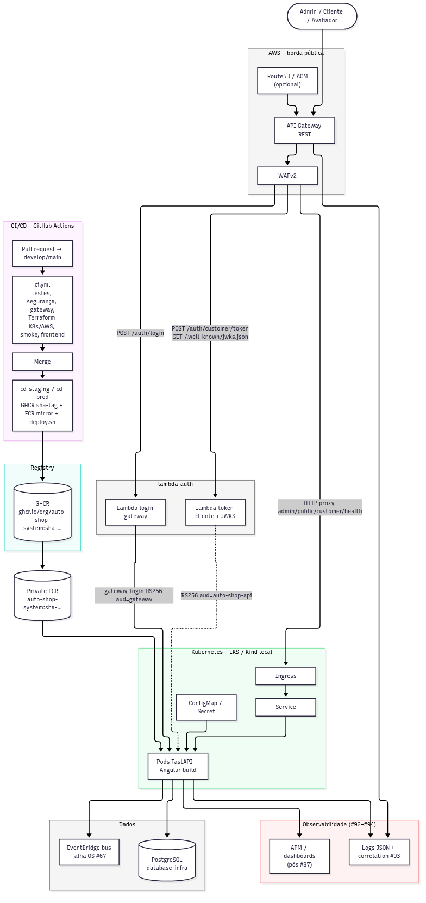

16SOAT

Tech Challenge - Fase III

Grupo 29

INTEGRANTES:

Suelen Cristina Pereira da Mata Vaz (@sucriss2)  
Gustavo Acacio Ferreira (@guga2202)

São Paulo - SP  
2026

# Entrega — Tech Challenge Fase 3

## Sistema integrado de oficina mecânica (Auto Shop)

Organização GitHub: [Software-Architecture-Group-7-FIAP](https://github.com/Software-Architecture-Group-7-FIAP)

Este documento atende ao **entregável do Portal do Aluno** (Fase 3): links dos quatro repositórios, vídeo demonstrativo, documentação arquitetural e confirmação de acesso do usuário avaliador `soat-architecture`.

---

## 1. Repositórios Git (quatro repositórios + CI/CD)

| Papel no desafio                                                                   | Repositório                                                                                | README                                                                                                  |
| ---------------------------------------------------------------------------------- | ------------------------------------------------------------------------------------------ | ------------------------------------------------------------------------------------------------------- |
| Aplicação principal (backend FastAPI + frontend Angular no monorepo) em Kubernetes | [auto-shop-system](https://github.com/Software-Architecture-Group-7-FIAP/auto-shop-system) | [README](https://github.com/Software-Architecture-Group-7-FIAP/auto-shop-system/blob/develop/README.md) |
| Function serverless — autenticação de cliente (CPF → JWT)                          | [lambda-auth](https://github.com/Software-Architecture-Group-7-FIAP/lambda-auth)           | [README](https://github.com/Software-Architecture-Group-7-FIAP/lambda-auth/blob/main/README.md)         |
| Infraestrutura Kubernetes (Terraform — VPC, EKS, ALB)                              | [k8s-infra](https://github.com/Software-Architecture-Group-7-FIAP/k8s-infra)               | [README](https://github.com/Software-Architecture-Group-7-FIAP/k8s-infra/blob/main/README.md)           |
| Banco gerenciado (Terraform — Amazon RDS PostgreSQL)                               | [database-infra](https://github.com/Software-Architecture-Group-7-FIAP/database-infra)     | [README](https://github.com/Software-Architecture-Group-7-FIAP/database-infra/blob/main/README.md)      |

**CI/CD e proteção de branches:** pipelines GitHub Actions em cada repositório; índice cruzado em [.github/ecosystem-templates/README.md](https://github.com/Software-Architecture-Group-7-FIAP/auto-shop-system/blob/develop/.github/ecosystem-templates/README.md). Deploy automático homologação (`develop`) e produção lógica (`main`) documentados em [.github/CD.md](https://github.com/Software-Architecture-Group-7-FIAP/auto-shop-system/blob/develop/.github/CD.md) e [BRANCH_PROTECTION.md](https://github.com/Software-Architecture-Group-7-FIAP/auto-shop-system/blob/develop/.github/BRANCH_PROTECTION.md).

**API Gateway e borda AWS (Terraform no monorepo):** [infra/aws/README.md](https://github.com/Software-Architecture-Group-7-FIAP/auto-shop-system/blob/develop/infra/aws/README.md).

---

## 2. Vídeo de demonstração (até 15 minutos)

**Link do vídeo (YouTube):** [https://youtu.be/mZ6VZ04t5gU](https://youtu.be/mZ6VZ04t5gU)
  
O roteiro previsto cobre, conforme o enunciado: autenticação com CPF via API Gateway/Lambda; pipeline CI/CD com build e deploy; consumo de APIs protegidas; dashboards New Relic; logs estruturados e traces. Referência: [docs/runbooks/README.md](https://github.com/Software-Architecture-Group-7-FIAP/auto-shop-system/blob/develop/docs/runbooks/README.md).

---

## 3. Documentação arquitetural

### 3.1 Índice geral

| Conteúdo                                                   | Link                                                                                                                                                                         |
| ---------------------------------------------------------- | ---------------------------------------------------------------------------------------------------------------------------------------------------------------------------- |
| Índice de arquitetura Fase 3                               | [docs/architecture/README.md](https://github.com/Software-Architecture-Group-7-FIAP/auto-shop-system/blob/develop/docs/architecture/README.md)                               |
| Diagramas, RFCs e ADRs (página única)                      | [docs/architecture/diagramas-fase-3.md](https://github.com/Software-Architecture-Group-7-FIAP/auto-shop-system/blob/develop/docs/architecture/diagramas-fase-3.md)           |
| RFCs (cloud, banco, auth, Gateway, CI/CD, observabilidade) | [docs/rfc/README.md](https://github.com/Software-Architecture-Group-7-FIAP/auto-shop-system/blob/develop/docs/rfc/README.md)                                                 |
| ADRs (decisions/)                                          | [docs/architecture/decisions/](https://github.com/Software-Architecture-Group-7-FIAP/auto-shop-system/tree/develop/docs/architecture/decisions)                              |
| Justificativa do banco + ER                                | [justificativa-banco-postgresql.md](https://github.com/Software-Architecture-Group-7-FIAP/auto-shop-system/blob/develop/docs/architecture/justificativa-banco-postgresql.md) |
| Observabilidade (#92–#94)                                  | [docs/observability/README.md](https://github.com/Software-Architecture-Group-7-FIAP/auto-shop-system/blob/develop/docs/observability/README.md)                             |
| Runbooks operacionais                                      | [docs/runbooks/README.md](https://github.com/Software-Architecture-Group-7-FIAP/auto-shop-system/blob/develop/docs/runbooks/README.md)                                       |
| Correlação ponta a ponta (#93)                             | [correlation-id-propagation.md](https://github.com/Software-Architecture-Group-7-FIAP/auto-shop-system/blob/develop/docs/observability/correlation-id-propagation.md)        |

### 3.2 Diagrama operacional (componentes + nuvem)

Fonte editável: [fase-operacional.mmd](https://github.com/Software-Architecture-Group-7-FIAP/auto-shop-system/blob/develop/docs/architecture/fase-operacional.mmd)  
Exportações: [PNG](https://github.com/Software-Architecture-Group-7-FIAP/auto-shop-system/blob/develop/docs/architecture/fase-operacional.png) · [SVG](https://github.com/Software-Architecture-Group-7-FIAP/auto-shop-system/blob/develop/docs/architecture/fase-operacional.svg)

### 3.3 Diagramas de sequência e API

| Fluxo                               | Documento                                                                                                                                                                                          |
| ----------------------------------- | -------------------------------------------------------------------------------------------------------------------------------------------------------------------------------------------------- |
| Autenticação de cliente (CPF / JWT) | [autenticacao-cliente.mmd](https://github.com/Software-Architecture-Group-7-FIAP/auto-shop-system/blob/develop/docs/architecture/diagrams/autenticacao-cliente.mmd) (+ PNG/SVG no mesmo diretório) |
| Abertura de ordem de serviço        | [abertura-os.mmd](https://github.com/Software-Architecture-Group-7-FIAP/auto-shop-system/blob/develop/docs/architecture/diagrams/abertura-os.mmd)                                                  |
| Componentes AWS Fase 3              | [componentes-fase-3.mmd](https://github.com/Software-Architecture-Group-7-FIAP/auto-shop-system/blob/develop/docs/architecture/diagrams/componentes-fase-3.mmd)                                    |

### 3.4 Swagger / Postman

| Artefato             | Caminho                                                                                                                                                                       |
| -------------------- | ----------------------------------------------------------------------------------------------------------------------------------------------------------------------------- |
| OpenAPI versionado   | [docs/api/openapi.json](https://github.com/Software-Architecture-Group-7-FIAP/auto-shop-system/blob/develop/docs/api/openapi.json)                                            |
| Swagger UI (local)   | `http://localhost:8000/docs` após subir a API                                                                                                                                 |
| Coleção Postman      | [auto-shop.postman_collection.json](https://github.com/Software-Architecture-Group-7-FIAP/auto-shop-system/blob/develop/docs/api/auto-shop.postman_collection.json)           |
| Ambiente Postman HML | [auto-shop-hml.postman_environment.json](https://github.com/Software-Architecture-Group-7-FIAP/auto-shop-system/blob/develop/docs/api/auto-shop-hml.postman_environment.json) |

---

## 4. Resumo das decisões (referência rápida)

| Tema                    | Registro                                                   |
| ----------------------- | ---------------------------------------------------------- |
| Provedor cloud          | AWS — RFC-0001, ADR-0071                                   |
| Banco                   | PostgreSQL em Amazon RDS — RFC-0002, justificativa + ER    |
| Autenticação cliente    | CPF + Lambda + JWT RS256/KMS — RFC-0003, ADR-0064          |
| API Gateway / WAF       | RFC-0006, ADR-0073                                         |
| CI/CD multi-repo + OIDC | RFC-0005, ADR-0074, ADR-0079                               |
| Observabilidade         | New Relic — RFC-0004, ADR-0078                             |
| Branches                | `develop` (HML) / `main` (PRD lógico) — ADR-0074, ADR-0077 |

---

## 5. Acesso do avaliador FIAP

**Confirmação exigida pelo enunciado:** o usuário GitHub `soat-architecture` deve ter acesso de leitura (colaborador ou equipe) em **todos os quatro repositórios** listados na seção 1.

**Status (preencher antes do envio no portal):**

- [x] auto-shop-system — `soat-architecture` adicionado  
- [x] lambda-auth — `soat-architecture` adicionado  
- [x] k8s-infra — `soat-architecture` adicionado  
- [x] database-infra — `soat-architecture` adicionado  

---

## 6. Observações para correção

- Homologação AWS e evidências ao vivo de observabilidade dependem de sessão autorizada e staging demonstrável (issue [#87](https://github.com/Software-Architecture-Group-7-FIAP/auto-shop-system/issues/87)); a documentação e o código descrevem o desenho-alvo e os procedimentos operacionais.
- Nenhum segredo, CPF/CNPJ real ou token aparece neste PDF; dados sintéticos são usados em dev/HML conforme ADRs.

---

*Documento gerado a partir de* `docs/entrega/tech-challenge-fase-3-portal.md` *no repositório auto-shop-system (branch* `develop`*).*

