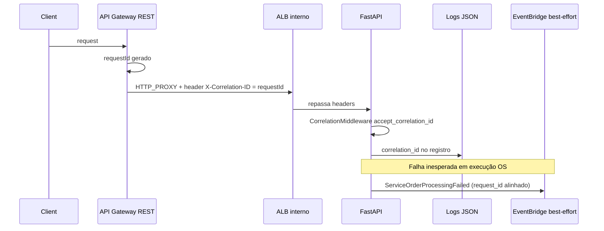

# Propagação de correlation ID (#93 — fatia 2)

Documento operacional da cadeia **API Gateway → backend FastAPI → logs JSON → falha de OS (#67)**. Cenários de APM/traces/métricas de infraestrutura (issue #93, cenários 3–7) ficam para **#92** após staging (**#87**).

## Identificador canônico

| Camada | Campo | Formato |
| --- | --- | --- |
| HTTP | `X-Correlation-ID` | String segura (ver validação abaixo); preferida sobre `X-Request-ID` |
| App / logs JSON | `correlation_id` | Mesmo valor bound no middleware |
| Histórico / evento OS | `request_id` | Mesmo valor passado pelos routers de execução (`request_correlation_id`) |
| API Gateway (access log) | `requestId` | ID gerado pelo Gateway (`$context.requestId`); mapeado para o header na integração HTTP |

Não logar CPF, CNPJ, tokens ou senhas. Valores com 11 ou 14 dígitos (documento brasileiro) **não** são aceitos como correlation ID no backend.

## Fluxo ponta a ponta (HML/PRD via Gateway)



## API Gateway

Integrações **HTTP_PROXY** para o backend definem:

```hcl
"integration.request.header.X-Correlation-ID" = "context.requestId"
```

Ver `infra/aws/api_gateway.tf` (rotas admin/public/customer/health). O cliente pode enviar `X-Correlation-ID`, mas na integração configurada o Gateway **define** o header de integração a partir do `requestId` do stage — use o access log JSON (`requestId`) e o header recebido no pod para correlacionar.

Access logs do stage incluem `requestId`, latência e status (CloudWatch).

## Backend FastAPI

1. **`CorrelationMiddleware`** (`src/api/correlation.py`): lê `X-Correlation-ID`, depois `X-Request-ID`; valida com `accept_correlation_id` (`src/infrastructure/observability/context.py`); gera UUID se ausente/inválido; devolve o ID nos headers de resposta; erros 500 incluem headers de correlação.
2. **`request_correlation_id(request)`** (`src/api/request_context.py`): usa `request.state.correlation_id` do middleware.
3. **Logs JSON** (`src/infrastructure/observability/json_logging.py`): inclui `correlation_id` quando presente no context var (eventos de negócio de OS seguem contrato separado em `new-relic-service-order-events.md`).

Rotas de execução (`src/api/routers/execution.py`) passam `request_id=request_correlation_id(request)` para o serviço de aplicação.

## Falha de processamento de OS (#67)

Em falha inesperada, `ExecutionService` publica `ServiceOrderProcessingFailed` com `request_id` igual ao correlation ID da requisição (`src/application/services/execution_service.py`). Logs de rollback/publicação usam `event_id`, `request_id` e `service_order_id` **sem** PII.

Decisões de domínio: [ADR-0066/0067](../architecture/decisions/ADR-0066-0067-os-cliente-e-evento-de-falha.md). Comunicação síncrona + evento: [ADR-0076](../architecture/decisions/ADR-0076-comunicacao-sincrona-e-evento-falha.md).

## Lambda de autenticação (fora do pod)

`lambda-auth` valida/propaga headers conforme [lambda-homologation.md](../validation/lambda-homologation.md) (UUID válido; precedência `X-Correlation-ID` sobre `X-Request-ID`). Instrumentação New Relic da Lambda: [lambda-auth-new-relic-handoff.md](./lambda-auth-new-relic-handoff.md).

## Verificação manual (staging)

1. Chamar um endpoint autenticado via URL do Gateway com `X-Correlation-ID: probe-<uuid>` quando a rota permitir header do cliente; caso contrário, anotar `requestId` do access log.
2. Buscar nos logs do pod o mesmo valor em `correlation_id`.
3. Forçar falha controlada em fluxo de execução (teste) e confirmar `request_id` no log de falha / payload do evento.

## Próximo passo (#92 / #93 cenários 3–7)

Traces APM, histogramas de latência, métricas de Pod e synthetic checks exigem agente New Relic (ADR-0078) e ambiente HML ativo. Não fazem parte desta fatia de documentação.

## Referências

- [ADR-0073 — API Gateway](../architecture/decisions/ADR-0073-api-gateway-borda-publica.md)
- Issue [#93](https://github.com/Software-Architecture-Group-7-FIAP/auto-shop-system/issues/93)
